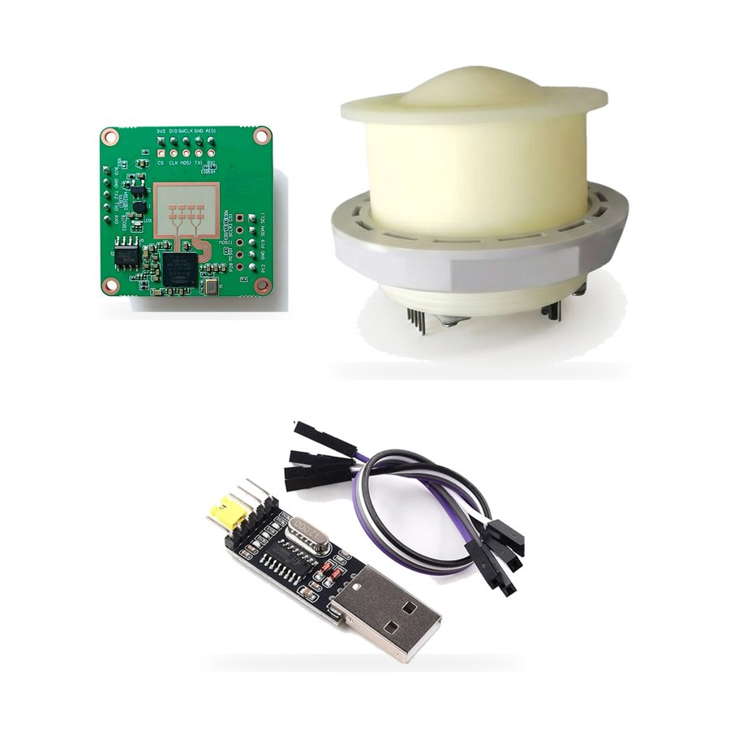
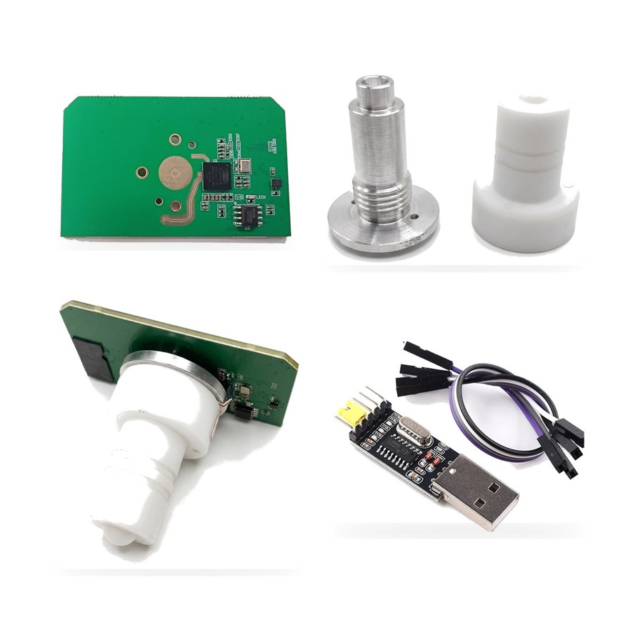

# Kymopsis 80 GHz Radar Level Sensor: GUI, protocol and user guide

Windows configuration GUI, UART communication protocol notes, user guide and datasheets for the
[Kymopsis 80 GHz Radar Level Sensor Development Kit](https://kymopsis.com/product/77ghz-level-radar-development-kit/?utm_source=github&utm_medium=readme&utm_campaign=radar-level-sensor-gui)
(76–81 GHz FMCW, 20 m and 60 m versions).

| 20 m kit: radar board + lens radome | 60 m kit: radar board + horn antenna + PTFE lens |
|---|---|
|  |  |

## What is in this repository

| Item | Where | Status |
|---|---|---|
| Configuration GUI for Windows (`RadarGUI.exe`) | [Releases](https://github.com/Kymopsis/radar-level-sensor-gui/releases/latest) | v1.0.0 available |
| UART communication protocol | [docs/protocol.md](docs/protocol.md) | In preparation |
| User guide: wiring, first measurement, settings | [docs/user-guide.md](docs/user-guide.md) | Draft |
| Datasheets (PDF) | [docs/datasheets/](docs/datasheets/) | Available |

## The two versions

| | 20 m version | 60 m version |
|---|---|---|
| Frequency | 76–81 GHz FMCW | 76–81 GHz FMCW |
| Antenna | PCB patch, 9 dBi, in a lens radome | Waveguide horn with PTFE lens |
| Range | 15 m typical, 20 m standard, up to 30 m with the lens radome | Up to 60 m |
| Accuracy (stated) | ±1 mm | ±4 mm at 20 m, ±8 mm at 60 m |
| Blind zone | 6 cm | 6 cm |
| Interface | UART0, 115200 baud | UART0, 115200 baud |

Figures are module maker datasheet values, not a Kymopsis lab report. Range and accuracy depend on
mounting, target, vessel and scene.

## Quick start

1. Connect the radar board's UART0 to the included USB-to-TTL adapter with Dupont wires, adapter set to
   3.3 V logic (see the [user guide](docs/user-guide.md)).
2. Download `RadarGUI.exe` from [Releases](https://github.com/Kymopsis/radar-level-sensor-gui/releases)
   and check its SHA-256 against the release notes (v1.0.0:
   `633fe765002f0d22892d71d6d2a64717e34a456c82952c2b9887372b261ed914`).
3. Start the GUI, pick the adapter's COM port at 115200 baud and read the distance.

Windows may show a SmartScreen warning because the GUI is not code-signed yet. Choose
"More info" → "Run anyway" only if the SHA-256 matches the release notes.

## Use and compliance

- This is a development kit for engineers, **not an FCC-certified end product**. See the
  [Buyer Terms](https://kymopsis.com/devkit-buyer-confirmation/).
- The level-measurement firmware is fixed. The kit is intended for level measurement **inside closed
  tanks and vessels**.
- Firmware and GUI source code are not published. For custom firmware or modules in volume, use the
  [B2B form](https://kymopsis.com/b2b/?utm_source=github&utm_medium=readme&utm_campaign=radar-level-sensor-gui)
  or email support@kymopsis.com.

## Support

Open an [issue](https://github.com/Kymopsis/radar-level-sensor-gui/issues) or email support@kymopsis.com.

## License

The GUI is provided free of charge for use with Kymopsis radar hardware. Documentation and images
© Kymopsis. All rights reserved unless stated otherwise.
